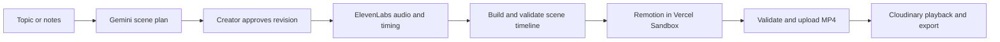

# Namaste Video pipeline architecture

Prove that one approved storyboard can produce a 60–90 second explainer with synchronized Indian-English narration, captions, and animated diagrams. Use one public topic, **Why does a solar eclipse happen?**, and a local runner with a hosted rendering test. [V1 PRD](PRD.md)

## Handoffs and state

| Stage | Saved output |
|---|---|
| Plan and approve | An immutable approved storyboard revision with stable scene IDs, narration, on-screen copy, supported diagram parameters, cue phrases, estimated duration, and the selected voice. Validate the plan before presenting it. |
| Narrate and align | Audio and character timings per scene. Derive caption phrases and animation cues from the timings, then calculate scene offsets from measured audio, pauses, and transitions. If duration falls outside 60–90 seconds, return the revision for review. |
| Render and export | A manifest for the approved revision references the timeline and audio assets. Remotion renders the manifest in Vercel Sandbox. Check the MP4’s portrait dimensions, duration, and streams, upload it to Cloudinary, and persist the asset reference before marking the run ready. |

Use a local manifest for the experiment. In the app, Next.js submits an approved revision, Inngest coordinates the work, and MongoDB Atlas stores revision and job state. Give each run a stable job ID and checkpoint each completed stage. Key reusable audio by scene narration, voice, model, and speech settings. A retry resumes from the last completed checkpoint. A newer revision creates its own run and cannot replace the earlier run’s output. The app restricts projects, jobs, and media access to their creator.

## Pipeline acceptance checklist

- [ ] Approve the eclipse storyboard and render a playable **1080 × 1920 H.264 MP4 with AAC audio**. Verify a measured runtime within **60–90 seconds** and review the diagram and caption readability on a phone.
- [ ] Verify the Moon’s shadow appears during the phrase that introduces it. Check that captions follow the narration and avoid overlapping diagram labels.
- [ ] Change only the shadow visual. Confirm the affected scene updates, neighboring scene content is preserved, and no new speech request is made.
- [ ] Revise the spoken explanation in one scene. Confirm only its narration regenerates, captions and cues are rebuilt, later scenes shift to match the measured timing, and the original export still plays.
- [ ] Interrupt a render after narration completes. Retry the same job and confirm it reuses the completed audio and produces one ready asset. Check that an invalid or out-of-range render never becomes ready.
- [ ] Render a **90-second** case in Vercel Sandbox. Close the sandbox and play the uploaded Cloudinary copy with sound.
- [ ] Record per-stage latency, provider usage or cost, retries, and manual corrections. Use these results to size the hosted workflow and decide what needs to change before the dashboard build.

Run Meta authorization separately with an eligible pilot account to verify the connected identity and publishing permissions. Use the pipeline results to inform the detailed MongoDB schema, Inngest job states, and recovery behavior.
