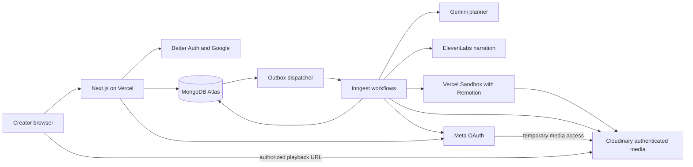

# Namaste Video dashboard and system design

**Implementation design for the internal pilot · 25 November 2026**

One signed-in creator owns one private workspace. A project can simultaneously have a draft being edited, a finished video available to download, and an older version scheduled for Instagram. The dashboard must show all three accurately. Use MongoDB Atlas as the source of truth for these records, Cloudinary for private media, and Inngest to coordinate work that survives browser closure.

The [final PRD](PRD.md) defines product scope. The [pipeline sketch](ARCHITECTURE.md) describes the original experiment. This document specifies the web application to build. The working local baseline is the six-scene water-cycle video with Daniel narration, phrase-level captions, and a separately exported condensation revision. Live Gemini planning, general-purpose scene selection, hosted rendering, sign-in, workspace isolation and Instagram dispatch still require integration tests.

## 1. Dashboard and navigation

For the implementation-level explanation, start with [the stack, markup and end-to-end engineering walkthrough](#10-engineering-walkthrough). It follows a single project from Google sign-in through a published Reel, including a frame calculation taken from the rendered Daniel video.

Use Next.js App Router with TypeScript. A server-rendered authenticated shell provides the project list, New project, and Settings. Render the editor and player as interactive client components. Route handlers and background functions share a Node.js domain layer for authorization, validation and state transitions. Keep provider SDKs and secrets in server-only modules.

| Route | What the creator sees | Primary actions and exceptional states |
|---|---|---|
| `/sign-in` | Google sign-in for the invite-only pilot | Preserve a validated, same-origin return path. An uninvited user can switch accounts. |
| `/dashboard` | Private projects ordered by recent activity. Each row shows title, thumbnail if available, last edit, generation stage and publishing status. A scheduled item includes the time and handle. | Create project or resume by ID. Show an empty workspace on first use, loading skeletons during fetch, and Retry on read failure. |
| `/projects/new` | Topic or notes field, example input and selected voice | Create the draft before planning. Preserve typed input on validation failure. Explain maximum length beside the field. For contradictory notes, show Gemini’s focused question and accept an answer in context. |
| `/projects/[id]` | Nearby stage navigation for Idea, Storyboard, Video and Publish. Persistent project title, save status and active job indicator. | Resume at the last useful stage. An old ready video remains accessible during a new render. A direct link to another owner’s project gives the same response as a missing project. |
| Storyboard view | Ordered scene cards with narration, on-screen text, visual description, cue and duration estimate. Show total estimated runtime. | Edit text directly or request a change to one scene or the project. Review proposed changes per scene, apply or discard, then select Generate video to approve the saved revision. |
| Video view | Vertical player, version, actual duration, voice, caption text and render status | Play, correct captions, request a revision, download MP4 or continue to Publish. Show the failed stage and a scoped retry when recoverable. |
| Publish view | Exact rendered version, connected Instagram handle, editable post caption, Post now and Schedule | Show local date, time, timezone and final confirmation. Show posted link, scheduled details, or recovery action. Replacing a schedule explicitly selects its new version. |
| `/settings` | Voice sample and default voice, connected Instagram handle, connection status | Preview and save voice, connect, reconnect or disconnect Instagram. Explain the effect on pending posts before disconnecting. |

**Layout.** On desktop, put the scene list and edit controls beside the preview. On a phone, show the preview and scene editor in one column, with stage navigation and an accessible primary action. Keep caption text visible inside the video safe area. Use labeled playback controls, visible keyboard focus, text status indicators and an announced save or failure state. After a dialog closes, return focus to the initiating control.

**Client consistency.** Initially load project, draft version, latest ready render and pending publications together. Poll active jobs every three seconds as a starting setting, back off for sustained inactivity, and refresh on tab focus. Debounce autosave, serialize outgoing writes and flush before approval or navigation. Display Saved only for an acknowledged version. Keep unsent changes in the current session during a network outage. A stale write opens a comparison between local edits and the latest saved draft. The creator can copy or reapply changes; automatic retries must preserve both versions.

## 2. Architecture and trust boundaries



Next.js responds once a command is durably recorded. Inngest receives identifiers, loads the corresponding job and checks its owner and state. A sandbox receives one immutable render manifest, scoped access to its audio, the pinned composition build, and upload authorization for the expected output. Provider credentials stay in the orchestration layer. The browser receives display data and time-limited media access. Publication is a separate command issued only after final approval.

## 3. Persistence model and indexes

Use BSON dates in UTC, stable opaque IDs, and explicit schema versions. Use the Better Auth MongoDB adapter for its own users, sessions, OAuth accounts and verification records. Keep Instagram publishing credentials separate from Google sign-in. For the pilot, the authenticated user ID is the workspace owner ID. Model ownership on child records to support scoped queries and background checks.

| Collection | Principal fields | Required access paths or constraints |
|---|---|---|
| `pilotInvites`, `preferences` | Normalized verified email, admission status; owner ID, default voice, preferred IANA timezone | Unique normalized invite email; unique preference owner |
| `projects` | Owner, title, notes, editable storyboard, draftVersion, lastStage, activeGenerationId, latestReadyRenderId, updatedAt | Index owner + updatedAt + ID for cursor pagination. Autosave filters on ID + owner + expected draftVersion. |
| `revisions` | Owner, project, parent revision, schema version, full approved scenes with stable IDs, voice snapshot, template build, content hash, approvedAt | Unique project + approved draft version; project + creation time for history. Immutable after approval. |
| `proposals` | Owner, project, base draft version, targeted scene IDs, proposed field changes, status | Project + status. Apply once against the matching base version. |
| `jobs` | Owner, project, kind, revision or base version, state, current step, attempt, lease expiry, checkpoint references, sanitized error, timestamps | Unique operation key per owner; index state + lease expiry for recovery. Progress writes check expected state and lease token. |
| `assets` | Owner, project, media type, input digest, immutable Cloudinary reference/version, bytes, checksum, duration, alignment reference, validation status | Unique owner + project + type + digest; server resolves asset IDs after access checks. |
| `renders` | Owner, project, revision, job, artifact reference, approved scene manifest, scene offsets, dimensions, codecs, frame count, verifiedAt | Unique generation job ID; index project + verifiedAt. Expose verified assets only. |
| `connections` | Owner, provider account ID, display handle, encrypted token envelope, expiry, grants, status, connection generation | Partial unique indexes on active owner and active provider account ID. Preserve previous identity references on historical publications. |
| `oauthStates` | Hashed random state, owner, bound session, expiry, consumedAt | Unique state hash, TTL on expiry. Check expiry explicitly on use. |
| `publications` | Owner, project, render ID, exact destination ID and connection generation, caption, approvedAt, scheduledAtUTC, timezone, state, scheduleVersion, provider container/media IDs, permalink | Owner + scheduled time; state + due time; unique owner + client operation key. |
| `outbox` | Event ID, job/publication ID, owner, expected version, kind, availableAt, attempts, sentAt | Unique event ID; index unsent + availableAt. |

Store media bytes outside MongoDB. Separate media identity from its temporary signed URL. For a confirmed command, write its state change, job and outbox event in one Atlas transaction. A dispatcher sends the event and then marks it sent. A periodic sweeper retries pending events and expired leases. A crash between send and acknowledgement can deliver the same event twice. The worker claims the operation conditionally and resumes checkpoints.

## 4. HTTP and application contracts

All routes below are under `/api`. Resolve the owner from the server session and verify admission on every protected route. Validate JSON against shared discriminated TypeScript schemas at runtime. Mutating commands that create work accept an `Idempotency-Key`. Store the operation’s request hash and result. Replaying the same request returns its original result; reusing a key with another payload returns 409.

| Method and route | Request → successful response |
|---|---|
| `GET /projects?cursor=…`, `POST /projects` | Paginated summaries and next cursor; topic/notes → 201 project and draft version |
| `GET /projects/:id`, `PATCH /projects/:id/draft` | Workspace snapshot; allowlisted field edits with expected version → incremented version |
| `POST /projects/:id/plans` | Saved input and base version → 202 planning job; on completion return a candidate storyboard or clarification |
| `POST /projects/:id/proposals`, `POST /proposals/:id/apply`, `DELETE /proposals/:id` | Plain-language instruction, targets, base version → proposal job; apply atomically or discard |
| `POST /projects/:id/generations` | Expected saved draft version and selected voice → 202 with approved revision ID and job ID |
| `GET /jobs/:id`, `POST /jobs/:id/retry` | Stage, attempt, retryability and result link; recoverable failure → resumed job |
| `GET /projects/:id/renders`, `GET /renders/:id/media?mode=download` | Version history; verified video → short-lived owner-authorized playback or attachment URL |
| `GET /voices`, `PATCH /preferences` | Available voice descriptors and sample audio; default voice and timezone → saved preferences |
| `POST /instagram/connect`, `GET /instagram/callback`, `DELETE /instagram/connection` | Authorization redirect; validate callback and redirect to Settings; disconnect and hold affected schedules |
| `POST /publications`, `GET /publications/:id` | Confirmed render, handle-bound destination, caption, optional schedule → publication ID/status; status read returns outcome and allowed actions |
| `PATCH /publications/:id`, `POST /publications/:id/cancel` | Expected schedule version plus confirmed replacement/reschedule, or cancellation → resulting state |

Example generation response: `{"jobId":"j17","revisionId":"r4","state":"queued"}`. Two tabs approving the same saved draft converge on one active generation. A project changed since review returns 409 with the latest draft version. Return 401 for expired sign-in, 403 for denied pilot admission, 404 for inaccessible resources, 422 for field errors, and 429 with retry timing for throttling. Include a correlation ID and actionable message. Background provider failures are job outcomes retrievable after the original HTTP request completes.

## 5. Planning, revisions and the render contract

1. **Plan.** Submit the creator’s notes, language, objective and a bounded catalog of supported templates to Gemini. Validate stable unique scene IDs, text limits, estimated durations, available visual parameters and cue references. Treat source notes as untrusted data. Store the candidate against its base version. Preserve the saved draft if the provider is unavailable or returns malformed output. A stale result is available for review. It cannot overwrite newer edits.
2. **Review.** Direct edits change the draft. Conversational edits return typed field changes against specific scene IDs. Show changed narration, captions and visual parameters side by side. Validate ownership, scene membership and base version on apply. Approving generation freezes a new snapshot. Future edits fork from that snapshot.
3. **Narrate.** Resolve the selected voice before approval. Daniel is the accepted pilot voice. Record the exact provider, model, voice ID, locale, pronunciation overrides and settings in each revision. The PRD’s Indian-English choices can appear when entitlements and samples are verified. The local MeloTTS configuration is an explicit alternative. If a pinned voice becomes unavailable, prompt the creator to audition and approve another.
4. **Align.** Save scene audio and timestamp alignment. Use measured samples for audio length and the provider’s character offsets for cue times. Store displayed captions separately from spoken text. Use stable phrase IDs for visual triggers. Build cumulative integer frame offsets at 30 fps with consistent rounding. Validate monotonic cues and full audio coverage. Missing alignment fails the stage. Overshoot or undershoot of 1,800–2,700 frames returns an actionable timing revision for approval.
5. **Render.** Resolve each supported template and its parameters into a Remotion composition. Pin bundle and template versions. Render H.264 video with AAC narration in a temporary Vercel Sandbox. Check file readability, both streams, 1080 × 1920 dimensions, measured runtime and artifact checksum. Upload as authenticated Cloudinary media. Reopen the persisted artifact and verify it before marking Ready.
6. **Commit.** Persist render and job completion atomically. Update the project’s current result only if the generation still matches the expected active generation ID. A late successful job remains in version history. The previous verified export stays downloadable during generation or failure.

| Change | Work to perform |
|---|---|
| Diagram, title or caption spelling | Reuse audio and alignment; validate caption display, rebuild manifest and export |
| Spoken words or pronunciation in one scene | Regenerate that scene’s audio and cues, recompute following offsets and check total runtime |
| Voice or speech settings | Generate or retrieve matching audio for all affected scenes; recompute timing |
| Instagram post caption or schedule | Update the publication approval/version; use the existing rendered file |

Cache speech per project with a digest of provider, model, voice, normalized spoken input, pronunciation and synthesis settings. Checkpoint only complete audio/alignment pairs. A render uses an immutable manifest including ordered scene IDs, display cues, offsets, template versions and asset references. Example visual instruction: `{"template":"water-cycle","stage":"condensation","dropletCloseup":true,"triggerPhraseId":"s3-p2"}`. The production catalog also needs general process, comparison and labeled-diagram compositions; test each with a second topic before enabling open topic entry. Map plans to trusted templates. Do not execute model-authored code.

## 6. Background processing and failure recovery

Generation states are queued → narrating → timing → rendering → validating → ready. Any active stage may enter retryable failure, permanent failure, or needs revision. Persist progress such as completed-scene count and last heartbeat. Configure initial concurrency at one render per creator and two across the pilot; tune from hosted measurements. Use a scene-level lease to limit duplicate synthesis. After an ambiguous provider response, recover a known asset or provider receipt first. Record any unavoidable duplicate provider usage.

Use Inngest durable steps for scene generation, timeline assembly, sandbox launch, completion checks and artifact finalization. Save sandbox and upload IDs immediately. Before a retry, check the known sandbox or deterministic asset reference. A successful upload followed by a database failure can be reconciled by digest, job and owner. Renew expired signed inputs on retry. Close the sandbox after durable upload verification, and reconcile abandoned sandboxes after crashes.

Retry 429, temporary service failures and network errors with bounded exponential backoff, jitter and provider retry hints. Treat denied credentials, unsupported templates and invalid input as action-required failures. Never spin up a render for an unapproved revision. A pilot operator can inspect failed operations and replay a recoverable stage by job ID with a recorded reason.

## 7. Instagram connection and publishing

Use Instagram Login for eligible professional accounts. Request the minimal basic identity and content publishing grants. The server creates random single-use OAuth state bound to owner, session, callback URI and expiry. Verify state and consume it atomically before exchanging the code. Fetch the authorized account identity, check grants and enforce the active connection uniqueness indexes. Encrypt the token with an authenticated cipher and versioned server-side key. Mask tokens in logs and UI. Refresh eligible credentials before expiry; on revocation or reauthentication failure show Reconnect.

On final confirmation, snapshot the immutable render, post caption, destination account, connection generation and approver. Store the IANA timezone and UTC instant. Default the UI to the creator’s timezone; show the explicit offset when a local time is ambiguous. Validate past times server-side. Now and Schedule use the same submission worker. Scheduling creates a versioned wake event for Inngest. Old wakes after cancel or reschedule exit when their expected version fails.

| Publishing state | Transition or recovery |
|---|---|
| Scheduled or queued | Claim only if still approved, due, owner admitted and destination matches. A missed schedule after an outage enters action required for a new time or Post now. Use a proposed five-minute lateness tolerance for normal queue delay and measure it in pilot tests. |
| Preparing | Obtain time-limited access to the verified file for Meta ingestion. Create the Reel container, persist its ID and poll readiness. Give the URL enough lifetime for the transfer and processing window. |
| Submitting | Atomically claim the right to publish the ready container. Once claimed, cancellation reports submission underway. Never silently redirect a pending post after reconnect or account replacement. |
| Processing or uncertain | Save Meta receipts and query the known container or media status. On timeout after the publish call, reconcile before any repeat. If the provider cannot establish the result, show action required and ask the creator to check Instagram. |
| Published, canceled or failed | Show the verified permalink when available, otherwise show recorded status. An explicitly approved new attempt uses a new operation key. |

Cancellation and dispatch compete through a conditional state/version update. Only one wins. Replacing a scheduled file or caption increments the schedule version and requires confirmation with the exact handle. Disconnect marks the connection inactive and holds undispatched jobs. A request already accepted by Meta may still finish; reconcile and show the real outcome.

## 8. Security, deployment and operations

- **Identity.** Use Better Auth with Google, verified email, server-side admission checks, secure HttpOnly session cookies and same-origin CSRF protection for mutations. Validate return URLs. Explicitly test revoked admission with an existing session and outstanding jobs.
- **Isolation.** Require owner filters on project, revision, job, publication and asset reads/writes. Sign private media access only after checking the requesting session. Configure authenticated media delivery and verify that an unsigned original or derived URL fails. Disable shared caching for private server responses.
- **Secrets.** Put secrets in ignored local environment files and separate environment-scoped deployment secrets. Use distinct sandbox, preview and pilot credentials, OAuth callbacks and Cloudinary namespaces. Verify Inngest signatures. Restrict sandbox inputs to trusted templates and scoped media references. Rotate any previously exposed development keys before hosted deployment.
- **Input and abuse controls.** Validate lengths, enums, IDs and allowed template fields server-side. Escape creator text. Resolve media by trusted asset ID. Reject user-supplied remote asset URLs. Bound prompt size, scene count, render retries and concurrent jobs with configurable limits. Surface capacity errors with retry guidance. Keep scripts, notes, raw provider payloads and tokens out of telemetry.
- **Deployment.** Pin Node, dependencies, browser, encoder and composition build in CI. Use the Node runtime for provider handlers. Reuse MongoDB clients across warm invocations. Configure regional placement based on latency tests. Use a test Meta account and isolated storage in staging. Keep long renders outside request handlers.
- **Observability.** Carry request, project, revision, generation and publication IDs across workers. Measure queue age, per-stage latency, render completion rate, publish lateness, unknown publication outcomes, provider usage, cache hits, sandbox minutes and cost per verified export. Flag repeated authentication failures, stale leases, undelivered outbox events and unexpected spend. Provide internal reporting only.
- **Capacity.** Size compute from measurements. At two render slots and a measured mean of five minutes per render, the theoretical ceiling is 24 renders/hour before retries and overhead. Treat five minutes as an example. A 90-second export at an assumed total bitrate of 5 Mb/s uses about 56 MB before auxiliary assets. Track actual bitrate, backlog and storage.
- **Availability.** An external outage should preserve acknowledged drafts and ready videos. Start with engineering targets of one second for p95 dashboard API responses and two seconds for save acknowledgement under pilot load. Measure generation and publishing independently. Formal retention, backup and disaster-recovery policies remain a later product decision. Test worker interruption and state reconciliation in the pilot.
- **Rollout and rollback.** Gate live planning, hosted generation and publishing independently. Deploy additive schema changes first. Store schema and template versions so old projects remain readable. Roll back the web build independently of pinned in-flight manifests. Disable new publishing during a provider incident, then reconcile outstanding submissions before enabling dispatch again.

## 9. Verification and implementation order

| Slice | Acceptance evidence |
|---|---|
| 1. Sign-in, workspace and draft editor | Two invited users see different dashboards. Direct links, media requests and job endpoints enforce ownership. Uninvited sign-in fails. Autosave survives refresh and concurrent edits produce a recoverable conflict. |
| 2. Storyboard review | Start with the accepted water-cycle fixture. Exercise scene diffs, apply/discard, caption corrections and version approval. Then verify a live Gemini response and an unrelated topic against the template catalog. |
| 3. Hosted generation | Run a full 90-second export through Inngest, Sandbox and Cloudinary; open the MP4 after sandbox closure. Test 60 and 90 seconds plus one frame outside either boundary. Verify frames, audio, cue placement and mobile safe areas. |
| 4. Revision and retry | Reproduce the condensation close-up with zero TTS calls; change one spoken phrase and observe exactly one affected scene synthesis on a clean run. Interrupt after upload and recover one ready artifact. A failed revision preserves the prior export. |
| 5. Connect and post | Test Meta eligibility and grants on individual pilot accounts. Confirm denied permissions, reconnect, exact destination, signed-media ingestion, successful Reel and provider receipt. |
| 6. Schedule and operate | Test timezone ambiguity, late wake, reschedule versus dispatch, cancellation versus dispatch, disconnect, duplicate events and lost publish responses. Confirm measured latency, cost and recovery behavior before inviting further testers. |

**First dashboard deliverable.** An invited creator signs in, creates a private draft, opens the water-cycle storyboard, edits one scene, closes the browser and resumes the saved draft. This exercises the web, identity and database boundaries before introducing external generation latency. The hosted render and Meta integration tests can proceed independently with pilot credentials.

**Implementation references.** [Better Auth MongoDB adapter](https://www.better-auth.com/docs/adapters/mongo) · [Inngest scheduled waits](https://www.inngest.com/docs/reference/functions/step-sleep-until) · [Remotion on Vercel](https://www.remotion.dev/docs/vercel) · [ElevenLabs speech timing](https://elevenlabs.io/docs/api-reference/text-to-speech/convert-with-timestamps) · [Meta Instagram platform updates](https://developers.facebook.com/docs/instagram/platform/instagram-api/changelog/)

## 10. Engineering walkthrough

### 10.1 Tools and where the code executes

There are three distinct execution environments. The creator’s browser edits and plays content. The Node.js application authenticates requests, saves data and authorizes work. The render environment runs a browser under program control to turn React output into video frames. Closing the creator’s browser must have no effect on a render that the server has accepted.

| Technology | Concrete responsibility | Current status |
|---|---|---|
| React and React DOM 19.3.1 | Build a scene from properties such as title, active stage, caption and elapsed time. React DOM lays it out in the rendering browser. | Installed in the prototype |
| TypeScript and TSX | Describe scene data and components. TSX permits elements such as `<Landscape />` inside TypeScript. External JSON still needs runtime validation. | Used in the scene components |
| Node.js and JavaScript ES modules | Read a manifest, call the provider, save audio, bundle the composition, start rendering and report progress. | Working local commands |
| Remotion, bundler and renderer 4.0.546 | Register the video composition, compile the TSX, render at frame indices, combine frames with audio, and produce the MP4. | Working local export |
| ElevenLabs and sherpa-onnx-node 2.0.3 | ElevenLabs supplies Daniel’s speech and character alignment. The optional local engine runs the downloaded MeloTTS Indian-English model and measures each generated phrase. | Both paths produced narrated exports |
| Gemini | Generate validated scene plans or propose revisions based on notes. Its response must pass the same schema checks as a manual draft. | Integration exists; the accepted Daniel export used the reviewed local script |
| Next.js on Vercel | Serve dashboard routes and authenticated Node.js route handlers. A page loads its initial owner-scoped snapshot on the server; a client editor handles typing, playback and pending saves. | Dashboard design |
| Better Auth, Google and MongoDB Atlas | Establish identity, check admission, persist private workspace data, and coordinate versioned writes across requests. | Dashboard design |
| Inngest and Vercel Sandbox | Deliver durable job events, run retryable steps and host the pinned Remotion rendering environment. | Hosted pilot integration |
| Cloudinary and Meta | Hold authenticated media independently of a sandbox, then deliver a specific approved export to the creator or authorized Instagram account. | Hosted pilot integration |

### 10.2 Markup and component boundaries

HTML elements carry meaning and browser behavior. React components group application behavior and eventually produce HTML, SVG or audio instructions. The proposed project editor can use the following structure. Identifiers and handlers here illustrate the dashboard contract.

```tsx
<main>
  <h1>{project.title}</h1>
  <nav aria-label="Project stages">{stageLinks}</nav>
  <section aria-labelledby="storyboard-heading">
    <h2 id="storyboard-heading">Storyboard</h2>
    <ol>{sceneEditors}</ol>
    <p role="status">{saveMessage}</p>
    <button type="button" onClick={approveSavedDraft}>Generate video</button>
  </section>
</main>
```

Each `sceneEditors` item renders an `<li>` with an `<h3>`, a `<label htmlFor={fieldId}>` and a matching `<textarea id={fieldId}>`. Use the stable scene ID as React’s key so reordering preserves the correct edit target. A stage that navigates uses an anchor. A command uses a button. For publication, use a labeled `<form>` with the post caption and time controls; confirmation displays the exact destination and version. Use a `<video controls playsInline>` for the completed asset. Its signed URL can expire, so the player can request renewed access while preserving playback position. Persistent labels, focus order and status announcements make these flows usable from a keyboard.

The video contains different markup. In the actual prototype, `<Composition>` declares dimensions and frame rate, `<Series.Sequence>` gives each scene a start and length, `<AbsoluteFill>` lays out the frame, and `<Audio>` places the scene’s WAV on the timeline. The scene title uses `<h1>`; the caption uses a styled `<div>` so its text is visibly embedded in exported frames. Inside `<svg>`, a `<path>` describes mountains, rivers and clouds, `<circle>` represents droplets, `<g>` moves or fades several shapes together, and `<text>` labels the illustration. `<defs>` holds the gradients. These elements become pixels in the MP4; keyboard controls belong to the surrounding dashboard player. [Scene composition](prototype/index.tsx) · [Animated landscape](prototype/landscape.tsx)

### 10.3 From sign-in to a saved draft

1. **Establish identity.** The browser starts Google sign-in through Better Auth. On callback, the server validates the authenticated identity and verified email, checks pilot admission, and establishes the session. The browser sends its session cookie on later same-origin requests. The application derives owner ID from the session each time. A submitted owner ID can never grant access.
2. **Load the workspace.** On `GET /dashboard`, the server reads the first page of projects filtered by owner. It returns display summaries and a pagination cursor. Use the pair of last-updated time and project ID as the cursor so projects with equal timestamps have a deterministic order. The browser can show a draft, latest playable export and scheduled destination on a single row because those values come from separate records.
3. **Create the project.** The creator enters notes and selects Create. The client generates an operation key and submits the notes. The server validates length and content, allocates the project ID and writes the draft with its initial version. A lost response followed by a retry with the same operation key must return the original project. Only after the save succeeds should the browser navigate to the editor.
4. **Autosave a field.** Suppose the browser loaded draft version 7. It submits a narration edit for scene `s3` with `expectedVersion: 7`. The database write filters by project, owner and version. A successful write increments the version to 8 and returns it. Text typed while that request was in flight remains pending and becomes the next write against version 8. If another tab already saved version 8, the server returns a conflict; the client retains the typed text alongside the current saved value.

### 10.4 From notes to approved work

**Planning.** Save the notes before sending them to Gemini. Pass a schema describing the supported scene types, fields, language, duration range and expected output. A general process scene needs ordered steps and phrase references; a comparison scene needs named items and comparable attributes. Validate the returned structure, estimated time, uniqueness of scene IDs and existence of each referenced phrase. If the model proposes a visual the renderer cannot draw, surface a supported alternative for the creator to review. In the water-cycle prototype the renderer specifically understands evaporation, condensation, precipitation, collection and cycle overview.

**Conversational revision.** For “show the droplet forming more clearly,” send the targeted scene, current visual parameters, available parameter choices and base draft version. A concrete candidate change is `{"sceneId":"s3","changes":{"dropletCloseup":true}}`. Display the visual change before applying it. Revalidate its type and scene compatibility on the server. A simultaneous edit invalidates the proposal’s base version. Applying a proposal changes the private draft; generating a video requires a subsequent approval of that saved draft.

**Approval transaction.** Generate video first flushes the editor’s pending save. The server checks the expected version, freezes the scenes and voice choice into an immutable revision, creates a generation job, and records an outbox event in one transaction. Return the job ID only after commit. If the worker service is unavailable, the saved event can still be delivered later. If delivery succeeds and marking the event sent fails, delivery can repeat; the worker checks the job ID and its lease before performing the step again.

### 10.5 From approved words to timed frames

For each scene, resolve the approved voice and look up matching audio. A caption correction can reuse the spoken words; changing “vapour” to a different spoken phrase changes the synthesis input. Include model and synthesis settings in the production lookup key, since the same words spoken at a different speed yield different cues. Save audio and alignment together before marking the scene complete. A restarted job can inspect these checkpoints and resume at the first incomplete scene.

The Daniel prototype requests mono 24 kHz, 16-bit PCM. One second contains 24,000 samples of two bytes each, so the script computes audio seconds as `pcmBytes / 48000`. It wraps the samples in a WAV header. ElevenLabs supplies character start times for the complete spoken string. The script finds the first character of each phrase and uses that time for its caption. The first caption appears at scene start. The current fixture places the visual reveal on phrase two. A production scene stores the cue’s phrase ID explicitly, which lets a different scene trigger a diagram on phrase one or three. [Narration implementation](prototype/generate.mjs)

**Measured example from the approved Daniel video.** Condensation begins at global frame **733**, or **24.433 seconds** at 30 fps. Daniel begins “Water vapour condenses into tiny droplets around airborne particles” **4.075 seconds** into that scene. The first eligible frame is local frame **123**, because frame 122 occurs at 4.067 seconds. The corresponding global frame is **856**, or **28.533 seconds** into the video. On that frame the caption changes and the close-up begins its fade. The fade lasts about 0.65 seconds. The third caption starts at a local time of 9.567 seconds. The entire scene occupies **443 frames**, and the complete video occupies **2,328 frames**. An engineer can reproduce the calculation using `sceneStartFrame + Math.ceil(cueSeconds * fps)`.

### 10.6 From a timed manifest to a downloadable file

**Prepare.** Assemble ordered scenes, measured frame lengths, caption cues, visual parameters and asset references. Validate the total and reject an out-of-range timeline before consuming sandbox compute. Pin the template build. The existing command reads WAVs from a local media directory. The hosted worker must resolve authorized assets into the sandbox and check their identities before rendering.

**Render.** Register the composition at 1080 × 1920 and 30 fps. For each frame the rendering browser evaluates the scene’s local time, picks the active caption and draws the corresponding positions of the vapour, cloud, rain and river. The encoder produces H.264 video and AAC audio. A visual-only revision still requires a video export; it can reuse all six audio files and timestamps. The preview for final publication should play the actual encoded file so the creator can approve exactly what will post. [Render implementation](prototype/render.mjs)

**Finalize.** Check the encoded file for readable streams, duration, dimensions and audible content. Upload with a job-specific immutable identity to authenticated Cloudinary storage. Persist the verified asset and render version. If upload succeeded and the database write failed, match the existing asset against the expected checksum and job before resuming. When the creator opens the video, first authorize its render ID, then issue temporary access. A later render failure leaves the last verified version available.

### 10.7 From Connect Instagram to a published Reel

The dashboard sign-in and the Instagram connection serve different purposes. Google identifies the creator in Namaste Video. Instagram authorizes one destination to receive a Reel. Connecting Instagram begins with a session-bound random state. Meta returns a code to the server callback. Consume the state once, exchange the code on the server, verify professional account identity and grants, store the encrypted credential, and show the verified handle. If the creator cancels, return them to the project with the export still available.

At scheduling time, the creator confirms the render version, handle, post caption, local time and timezone. For example, **18:00 Asia/Kolkata** corresponds to **12:30 UTC** on the same date. Store the UTC instant for dispatch and the timezone for display. A worker waking for schedule version 1 must exit if the creator has already saved version 2. Immediately before dispatch it rechecks the destination, credential and current approval.

The worker makes the specific approved media temporarily accessible to Meta, creates a Reel container, saves its identifier and checks readiness. When ready, it claims the publish transition and submits the container. The most consequential failure is a timeout after that call: Instagram may have posted successfully. Recover using the saved provider identifiers. Show the creator an uncertain status if the outcome cannot be established. This keeps a transport retry from publishing a second copy.

### 10.8 How to know the first dashboard slice works

Use two invited test accounts and one uninvited account. With the first invited account, create a project, load a water-cycle fixture as the initial storyboard, edit a scene and refresh. Compare the returned project ID, scene ID and saved text. Open the project in a second tab and produce a deliberate version conflict. Confirm that the editor preserves both the saved and pending values. With the second invited account, attempt to open the first project using its direct URL and its API ID; both must deny access. With the uninvited account, verify admission is denied even after Google sign-in succeeds.

For the subsequent render slice, count TTS calls and compare asset references across revisions. A close-up edit should produce a new render version with the original speech assets and matching cue times. A spoken change should regenerate the affected audio and shift all following scenes by the measured duration difference. For the publishing slice, test a disconnect while scheduled, a cancel racing with dispatch, and a lost provider response. Capture the visible status, database transition and provider receipt for each case so failures can be diagnosed at the correct boundary.
